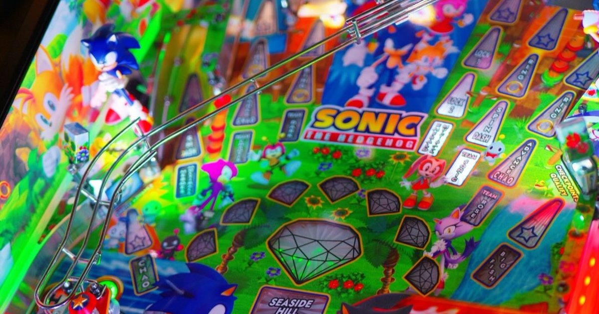

# Eclipse Pinball



A website for Eclipse Pinball in Richmond, Virginia. Built with plain HTML, CSS, and JavaScript, with an arcade-inspired design and practical details for planning a visit. Designed and built by Dylan Hughes for Eclipse Pinball.

[Visit the site](https://www.eclipsepinball.com/)

## What it does

- Shows the machine lineup with era filters and a visible checked date.
- Keeps a saved lineup in the page so the list still works if the JSON request fails.
- Presents hours, admission, events, FAQs, directions, and contact options.
- Offers call and text choices on supported devices, with regular phone links as a fallback.
- Uses keyboard-friendly navigation, visible focus styles, and reduced-motion support.
- Publishes through GitHub Pages after checking the data, links, scripts, and local assets.

The visual design uses neon color, arcade typography, an animated eclipse, and a subtle CRT treatment. Fonts and Instagram images are served locally.

### Design choices

- **Three fonts, three jobs.** Orbitron names things (headings, machine titles, buttons, nav), Rajdhani carries everything people read, and Share Tech Mono shows data (dates, counts, labels, the readout). Sizes come from one type scale, so the page stays consistent.
- **One motion moment.** On load the moon crosses the sun and the corona lights at totality, then the hero holds still. Only the slow grid floor and the corona's glow keep moving. I left out scroll fade-ins and hover lifts because they make a page feel generic.
- **Colors have jobs.** Cyan marks things you can press and lamps that are lit. Magenta is for tournaments and events. Amber is the dot-matrix readout and pre-1990 machines. Violet is atmosphere only.
- **Headings carry data, not decoration.** Each section heading is followed by a real fact (a count, a date, a neighborhood) rather than a label above it.
- **Copy stays true as the lineup changes.** The hero and meta description don't name specific machines or years, since the lineup is updated by hand.

## Stack

HTML, CSS, JavaScript, Node.js maintenance scripts, and GitHub Actions. The website has no build step. The maintenance scripts use Node.js built-ins, so there are no packages to install. The deployment workflow uses Node.js 22.

## Run locally

From the repository root:

```sh
python3 -m http.server 8000
```

Open [localhost:8000](http://localhost:8000).

Use a local HTTP server when checking the data-driven sections. Opening `index.html` directly uses the saved game lineup because browsers restrict local file requests.

## Deployment

The `Deploy site` workflow runs on pushes to `main`, daily at 09:00 UTC, and on demand. It optionally refreshes the game list, synchronizes the saved fallback, validates the site, and deploys an explicit set of public files to GitHub Pages.

If `PINBALL_MAP_TOKEN` is unavailable, the workflow keeps the committed lineup. An API failure also leaves the saved list in place.

Keep the existing custom domain and Pages configuration when making content changes.

## Maintaining the site

Project structure, how to update the lineup, Instagram posts, events and FAQs, credentials, and search and performance notes are in [MAINTAINING.md](MAINTAINING.md).
